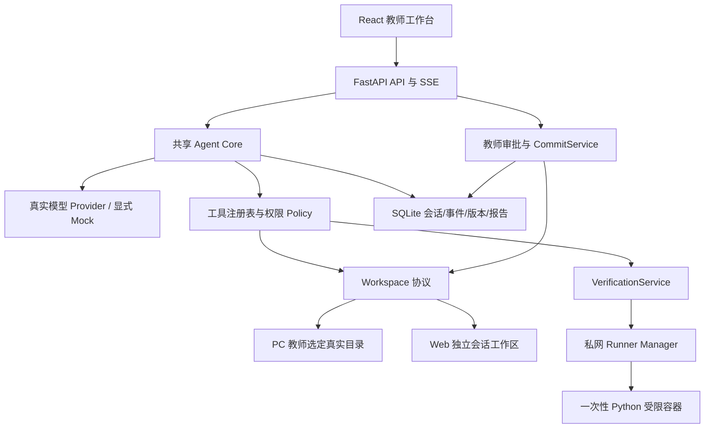
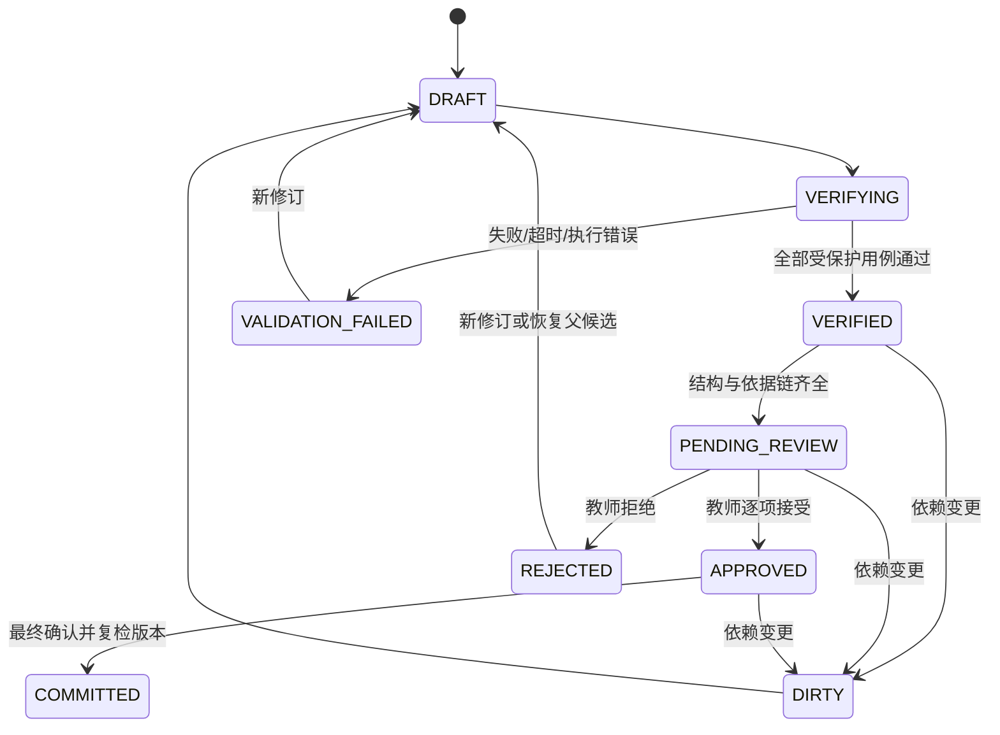

# 架构与实施计划

**初始设计日期：2026-10-29（Asia/Shanghai）；2026-10-30用户要求删除全部模型预算约束。架构历史说明保留，当前实现与验收以PROGRESS/ACCEPTANCE最新节为准。**

本轮修改 PLAN、ACCEPTANCE、PROGRESS，并按用户追加要求为 DESIGN_DECISIONS 补充简短产品交互说明。下文的模块、接口、命令和阈值均为实施契约，不代表已有源码或已通过测试。功能验收的实际状态以 [ACCEPTANCE.md](ACCEPTANCE.md) 为准。

## 0. 目标、边界与关键决定

- 48 小时先交付初二《循环结构》的教师备课闭环：一句话需求 → 读取班情与工作区 → 结构化草稿 → 所有示例和参考解真实验证 → 教师逐项审核 → 正式落盘/下载。45 分钟课时取自后续教育阶段约定，可配置，但首个验收固定为 45 分钟。
- 保留 Python 3.12 + FastAPI + Pydantic + SQLite、React + TypeScript + Vite + Tailwind/shadcn、pytest + Playwright；目前没有推翻技术栈的硬阻塞。直接实现串行 mini Agent Loop，不引入多 Agent、重型编排、Redis/Celery。
- PC 使用本机 FastAPI 服务与浏览器 GUI，首个支持平台为当前 macOS arm64；Web 复用同一套界面与 Agent Core。Windows 打包、Electron/Tauri 不进入本轮交付范围。
- 教育内容以版本化 JSON 为事实源，Markdown/Python/ZIP 为派生产物；执行报告只由真实 Runner 产生，正式写入只由审批服务授权。
- “代码在这些用例下通过”“教学适合这个班”“教师同意正式发布”分别记录，不能互相替代。未测试、失败、超时、执行器不可用均阻断正式教案包交付。
- 不做账号注册/付费、学生端聊天、完整 IDE、教务对接、多语言执行、移动端和视觉打磨。公开演示保留最小会话隔离，不引入账号体系。
- 题目收到时间与真实截止时刻未提供；以下 0–48h 为工作预算，不能据此声称截止时间或已耗时。

## 1. 原题覆盖与首个验收场景

原始要求保持不改；逐条可观测标准、测试入口和状态见 [ACCEPTANCE.md](ACCEPTANCE.md)。其中 B2 同时对应“真实验证”和“拒绝回退”，故拆为 B2/B3；原题 B3 对应 B4，原题 B4 对应 B5/B6。

| 原题 | 设计责任 | 验收 ID | 首次实现阶段 |
|---|---|---|---|
| A1 自然语言、工作区读写、新文件/diff、接受/拒绝/续改 | AgentLoop、ToolRegistry、Workspace、审批 | A1、B3 | 2；完整审批在 5 |
| A2 真实运行代码 | Runner、VerificationService | A2、B2 | 3；阶段 1 做独立最小探针 |
| A3 多轮与恢复 | SessionStore、事件日志、checkpoint | A3 | 2 |
| A4 至少一个真实模型、Mock 标识 | Provider、用量记录 | A4 | 1 探针、2 接入 |
| A5 权限分级 | Policy、审批与路径边界 | A5、C3 | 2、5 |
| B1 结构化、可复用、逐项操作 | 教育模型、稳定 ID、渲染器 | B1、B3 | 4、5 |
| B2 全部示例/参考解跑用例、失败定位、回退 | 验证闸口、版本关联 | B2、B3 | 3、5 |
| B3 班情关联的错因预警 | 事实 → 策略 → 干预依据链 | B4 | 4 |
| B4 学段与班情适配 | StageConfig、ClassProfile、策略规则 | B5、B6 | 4 |
| C 本机启动、真实目录、命令/写入权限、全部教育能力 | LocalWorkspace、PC 启动入口、同一核心 | C1–C4 | 1 预检、5 闭环 |
| D URL、5–15 个种子文件、真实教育闭环和教案包 | SandboxWorkspace、独立 Runner、导出 | D1–D4 | 1 部署探针、5 闭环 |
| 交付物及现场 | README、视频、源码历史、现有教育判断/AI 日志文档 | E1–E5 | 持续留证、6 汇总 |

首个完整场景：初二、刚学完条件语句，输入“5 人未交、3 人 while 死循环”。保留两项观察的来源与未知交集，不能合计为“8 个不同学生”；若班级总人数未知，不生成比例。成功产出须含 2–3 个示例、基础/进阶/挑战各 1 题、评分点、45 分钟环节与有依据的错因预警，所有可交付代码有当前版本的执行证据。

## 2. 共享核心与宿主边界

| 拟建模块 | 职责与明确边界 |
|---|---|
| `backend/app/domain/` | Pydantic 教育/工作区/会话协议、状态机和不变量；不依赖 GUI 或部署模式 |
| `backend/app/agent/` | Loop、上下文组装、用量记录、checkpoint；不能直接写正式文件或执行任意 shell |
| `backend/app/providers/` | API 差异、原生 tool_calls、用量和错误归一化；密钥只留服务端 |
| `backend/app/tools/` | 工具 schema/handler/policy；输入校验、审计、幂等键；不接受模型自报权限 |
| `backend/app/workspaces/` | Local/Sandbox 适配、路径安全、草稿、快照、受审批约束的提交 |
| `backend/app/education/` | 学情解析、教学策略规则、课程约束、JSON 与 Markdown 渲染 |
| `backend/app/verification/`、`runner/` | 可信测试规格、派发、外部比对、真实执行结果；Runner 无模型 Key/教案目录 |
| `backend/app/storage/`、`api/` | SQLite 仓储、恢复、SSE、教师操作接口；API 不持有 Docker Socket |
| `frontend/src/`、`scripts/` | 同一教师 GUI，PC 启动/后续部署入口；审批决策必须到服务端校验 |

首版一个 API 进程、一个串行后台任务执行器，长任务不阻塞 HTTP 事件循环；SQLite 保存作业和事件，无需独立任务队列产品。每会话至多一个活动 run，正式提交按 workspace 加锁并校验版本。Web 初期全局只运行一个代码验证作业，排队有上限；跨进程扩容不属于 P0。

| 能力 | `LocalWorkspace`（PC） | `SandboxWorkspace`（Web） |
|---|---|---|
| 根目录授权 | 启动时 `--workspace` 或本机教师打开目录操作，由后端绑定真实根路径 | 服务端从固定种子复制到随机 session 根；客户端不能传服务器根路径 |
| 共享协议 | `list/read/create_draft/diff/snapshot/commit/restore/export`，均有 workspace_id、相对路径和 base_revision | 完全相同；后端负责解析存储根，不另写教育逻辑 |
| 草稿/版本 | 授权后可写 `.yunyun/drafts/`、`.yunyun/revisions/` 受管区域；不能用草稿路径覆盖正式文件 | 同一逻辑目录放会话卷，配额和生命周期由服务端控制 |
| 正式修改 | 真实写入教师目录；创建、覆盖、删除、恢复均经具体 diff 确认 | 修改会话副本；同样保留审批和版本，不能影响原始种子/其他会话 |
| 运行 | 优先使用本机容器 Runner；不可用时仅允许教师显式授权的有限防护模式 | 只允许私网独立 Runner；隔离不可用则关闭代码执行和正式交付 |

SQLite 放宿主应用数据目录（Web 为专用持久卷），不暴露为模型可编辑文件。目录授权不等于授予读取密钥的权限；默认排除 `.env`、私钥、`.git`、内部数据库和版本日志。初版只处理 UTF-8 教学文本、JSON、CSV、Python 文件。

## 3. Provider、工具注册与实际能力判定

### 3.1 模型 API 选择

2026-10-29 用户已选定阿里云百炼作为阶段 02 的模型接入平台，官方文档已核对；尚未配置本地凭据或发起模型 API 请求。平台选择不等于接入成功，以下“文档支持”不能记为 A4 PASS。

| 顺位 | 候选与模式 | 工具调用的明确依据 | 上线前仍需确认 |
|---|---|---|---|
| 已选平台/初始模型 | 阿里云百炼兼容 Chat Completions；按用户要求采用旗舰档 `qwen3.8-max`，阶段 02 先关闭 thinking 验证工具协议，模型 ID 可配置 | [官方模型目录](https://help.aliyun.com/zh/model-studio/models)将该模型用于复杂推理与编程；[Function Calling 文档](https://help.aliyun.com/zh/model-studio/qwen-function-calling)列出 Qwen3.8-Max 支持原生工具调用 | 本地安全配置凭据，实际确认账户模型权限、余额/限流、usage、工具调用往返；其他百炼模型启用前分别验证 |
| 演示降级 | `MockProvider` | 固定响应，界面、事件、导出元数据显著带 `MOCK_LLM` | 不满足 A4；Runner 仍必须真实执行，禁止 Mock 报告 |

用户指定 base_url 为 `https://dashscope.aliyuncs.com/compatible-mode/v1`。阶段 02 拟用 `LLM_PROVIDER=bailian`、`DASHSCOPE_BASE_URL`、`DASHSCOPE_API_KEY`、`LLM_MODEL` 配置平台、地址、凭据和模型；不因选择模型新增一套 Agent Core，也不默认开放所有模型。只记录非敏感的配置约定，密钥不进入文档、源码或 Git；本轮不写 `.env`。模型切换仍须满足原生 tool calling、结构校验要求。

2026-10-29 核对的[百炼北京地域实时原价](https://help.aliyun.com/zh/model-studio/model-pricing)：`qwen3.8-max` 输入 ¥12/百万 token、输出 ¥36/百万 token。沿用单 run 与项目费用上限，不因升级旗舰模型自动扩额；账户权限、优惠与实际消耗尚未验证。

不依赖“兼容 OpenAI”字样判定能力。Provider 标准接口为 `complete(messages, tool_schemas, limits) -> ModelReply(content, tool_calls[], finish_reason, usage, provider_metadata)`；保留原生 call ID 和工具/结果配对。HTTP 超时、鉴权、限流、无效 schema、截断分别返回可识别错误。SDK 或 HTTP 客户端可复用兼容协议，模型特有参数由各 Provider 管理。

P0 先用非流式模型响应，SSE 流式展示工具/验证进度；不向用户输出隐藏推理。禁用 thinking 可缩小协议差异；若以后启用，必须按厂商要求保存并回传必要字段，另做契约测试。Pydantic 永远校验参数和产出，不能依赖 Beta strict schema 保证安全，也不把自然语言中的“调用工具”解析为已执行。

0–5h 的真实 Provider 探针须：模型决定调用 `read_file` → 应用实际读一个无敏感信息的 fixture → 把真实内容与 call ID 回传 → 模型利用文件中的随机标记作答；再完成第二轮对话。保留脱敏消息、调用 ID、usage 与结果。只有 HTTP 200、普通聊天成功或模型声称读过文件均不够。初始模型失败时先定位权限/参数/能力问题，再显式切换经验证的百炼模型并记录原因，不能无提示切成 Mock。

### 3.2 工具注册表与权限

注册项至少包括 `name/version/description/input_schema/output_schema/permission/allowed_modes/timeout/idempotency/handler`，schema 由 Pydantic 导出。工具结果统一为 `call_id, ok, data, error{code,message,retryable}, evidence_ref, content_hash`；记录真实开始/结束和摘要。模型只能使用白名单，不开放任意 shell、SQL、下载或自定义 Python 宿主命令。

| 权限 | 工具/操作 | 默认策略 |
|---|---|---|
| L0 授权范围只读 | `list_files`、`read_file`、`get_verification` | 已绑定工作区内自动执行；大小/路径/敏感文件限制仍生效 |
| L1 草稿写 | `propose_patch`、`upsert_lesson_draft`、`propose_test_spec` | 只生成新版本和 diff，不触碰正式文件；测试建议不能替换受保护规格 |
| L2 受限验证 | `run_python_tests(artifact_ids, test_spec_revision)` | 已验证容器策略内自动运行；PC 有限防护模式需教师对本次代码 hash 和风险显式确认 |
| L3 正式修改/删除 | `request_publish(change_set_id)` | 仅创建待审批请求并暂停；工具本身不能接受审批、提交、删除或绕开教师 |

教师更正班情、编辑草稿、批准测试规格、接受/拒绝、正式写入、版本恢复均走独立的人类操作 API；`approve/commit/restore` 不能注册给模型。每次请求先验证会话、权限、参数、路径、版本，再调用 handler，UI 隐藏按钮不能代替后端检查。

## 4. Agent Loop、停止与恢复

### 4.1 执行顺序

1. 保存教师消息、workspace/profile/revision、Provider/工具/策略版本与调用记录，创建 run 幂等键。
2. 组装稳定前缀（角色规则、工具 schema、课程约束）和可变上下文（事实、版本指针、消息、真实工具结果）；调用真实 Provider。
3. 保存 assistant 消息与完整 tool_calls；按返回顺序串行校验、执行，不并发产生文件副作用。未知工具/无效参数作为错误结果回传，不能“猜着执行”。
4. 每次真实工具完成即事务保存结果、事件与 checkpoint，追加匹配 call ID 的 tool 消息；同一批调用全部获得结果后才再次请求模型。模型据失败报告提出修复；Workflow 仅约束权限与交付，不用固定生成流水线冒充模型选择工具。
5. 遇到待审批，先保存当前 call、未执行列表、审批快照和调用记录，再进入 `WAITING_APPROVAL`，不继续向模型请求。逐项接受只改变审核状态；教师最终确认且提交服务完成操作后，才回填原 call 的执行结果；拒绝则回填 `APPROVAL_DENIED`。未执行调用恢复时重新校验依赖，整批结果齐全后恢复模型推理。
6. 模型无工具调用并给出最终消息时结束本轮。服务端仍独立判断结果为草稿/验证失败/待审核/已提交；文本“全部完成”不能提升任何状态。

Run 状态：`READY → RUNNING → WAITING_APPROVAL / COMPLETED / FAILED / STOPPED / INTERRUPTED`。教师取消和无进展均是有原因的 STOPPED；执行器故障是 FAILED，不能被转成 PASS。等待审批暂停后续推理；调用次数与耗时只作追溯。

### 4.2 调用记录与执行保护（2026-10-30按用户要求修订）

应用不设置模型费用、累计输入/输出Token、模型步数、工具总次数、累计运行时长或单次输出Token预算，不做预扣或未知费用预留。Provider不发送max_tokens/max_completion_tokens。真实用量与已知价格只用于记录；未知价格/用量如实标识，不阻断调用。此前相关限制要求已删除。

| 执行保护 | 当前行为 |
|---|---|
| 单次模型请求 | 超时60秒，暂时性网络错误最多重试2次；鉴权/协议错误明确失败，不切Mock |
| 无进展与代码修复 | 连续重复无进展停止；同一代码至多2次自动修复，不能更改冻结规格 |
| 工具与代码运行 | 工具各有独立超时；代码用例2秒/程序30秒、CPU/内存/pids/输出/路径与网络隔离保持 |
| 教师控制 | 可取消任务，正式写入仍需精确Diff审核；不会因取消删除历史 |

### 4.3 持久化与上下文

- SQLite 表按 session/run/message/tool_call/event/artifact_revision/test_spec/report/approval/workspace_revision/usage 分责，单库本机持久化；消息、事件序号、状态迁移在同一事务提交。
- 保存会话实际配置、原始工具消息及 call ID、草稿/文件 hash、冻结测试规格、验证报告、待审批列表、用量记录、工作区绑定与最近成功 checkpoint。恢复必须重建这些状态，不能只还原聊天。
- 重启后 RUNNING 标为 INTERRUPTED。只读调用可安全重跑；验证先查询 Runner job_id，无法确认则记执行中断并重新跑；草稿写按幂等键查询；正式写入按提交日志与文件 hash 对账，禁止自动重放未确定结果的写/删。
- 上下文达到 12k token 或 Provider 窗口 70%（取更小者）时，在完整工具调用/结果边界压缩。保留稳定规则、班情事实与未知项、未完成目标、调用记录、报告/版本指针和审批状态；工具原始证据留库，按需再读。未结束的 call/result 对不能截断或伪造。
- 压缩摘要是辅助索引；事实、PASS、授权只能从结构化存储恢复。保持 system+tools 前缀和工具顺序稳定；换 Provider、schema 或 Policy 生成新配置版本，不能为缓存复用旧权限。

## 5. 结构化协议与教育依据链

所有实体采用 `schema_version`、稳定 `id`、递增 `revision`、时间、来源；编辑创建新版本，不覆盖旧记录。关联必须指向具体 revision，不能用同一个 ID 偷换内容。

| 实体 | 必需内容与约束 |
|---|---|
| `ClassProfile` | 学段、年级、主题、已学内容、班级人数可空、来源文件/hash/字段或文本位置、facts、unknowns；每条 fact 的计数/分母/可重叠性与 observed/teacher_confirmed 状态 |
| `TeachingStrategy` | rule_id、evidence_ids、适用学段、推导说明、行动（时间/示例/练习/干预）、目标对象；规则只得出优先级和建议，不能把推测病因写成事实 |
| `LessonPlan` | 主题/学段/profile_revision、目标与可观察达成标准、先修、环节及分钟数、example/exercise/misconception/strategy 引用、教师审核状态；环节总和等于课时 |
| `Example` | 知识点、讲解步骤、预期观察、Python 代码 artifact、任务 I/O 契约、test_spec_revision、关联错因；一个完整教案含 2–3 个 |
| `Exercise` | 基础/进阶/挑战、题干、知识点/先修、参考解 artifact、用例规格、评分点（每题合计 100）、关联策略/错因；三档各 1 道 |
| `Misconception` | misconception_type、evidence_ids、trigger、cause、teaching_intervention、exercise_ids、stage、observed/predicted；无数据的错误类型只能标为预测 |
| `TestCase` | 稳定 case_id、task_contract、stdin、expected_stdout、比较规则、边界分类、timeout；P0 仅 stdin/stdout 程序，比较在候选进程外完成 |
| `TestSpec` | case 集合、来源（固定基准/教师/模型建议）、revision/hash、审批状态；已冻结规格不能由模型改写，新增建议另存候选 |
| `VerificationReport` | report/job/artifact ID、code_hash/test_spec_hash/runtime_digest/runner_policy_hash、逐 case actual/stdout/stderr/exit_code/duration/error、总状态、时间与证据引用 |
| `Approval` | 教师 actor、具体操作和逐项决定、candidate/content_hash、base_revision 与目标文件旧 hash、测试规格/报告指纹、Policy 版本、diff、接受/拒绝/过期时间；模型无写权限 |
| `WorkspaceRevision` | parent、文件增/改/删清单与前后 hash、快照、commit_id、对应 approvals、应用/回滚日志；用于幂等、冲突检测与恢复 |
| `Session` / `Run` | workspace/mode/profile/stage/provider/model、消息/工具/事件、checkpoint、pending calls/approvals、状态、实际用量、最后事件游标；会话与一次请求分开 |

### 5.1 班情事实怎样影响产出

粘贴文本或上传 JSON/CSV → 校验/结构化事实 → 教师可更正的事实预览 → 确定性策略规则 → 模型在规则约束下拟稿 → 结构校验与真实代码验证 → 教师教育审核。自由文本提取不能丢掉原始位置，未知分母/交集保持空值，冲突数据显示问题，不默默选一个值。

先定义两份明确标注为合成的种子班情，固定主题、课时和模型配置做对照：

| 输入/依据 | 必须发生的教学变化 | 可观察验收 |
|---|---|---|
| 班情 A：5 人未交、3 人死循环，学生集合交集未知 | R01 增加先修诊断；R02 增加 while 条件/变量更新追踪与有界运行；基础练习提供追踪表 | 对应 strategy.evidence_ids 指向这两项事实；相关环节分钟和示例/练习实际改变 |
| 班情 B：明确未交 0、死循环 0、边界错误 8（合成数据） | R03 增加 range 开闭区间、零次循环、n=0/1 的比较；减少先修补课与终止追踪 | 边界练习权重/评分点/示例至少一处实质改变，不能只替换班级名字 |
| 初中配置 | 具体情境、跟踪变量、条件更新、计数/累加；默认禁用递归、复杂数据结构与形式化复杂度要求 | 术语、先修白名单、练习难度校验；超纲项目标记后阻断待交付 |
| 大学入门配置 | 相同主题下增加循环不变量的直观论证、终止性、嵌套循环与复杂度分析，评分含思路解释 | 至少目标/示例或练习/评分点三处与初中实质不同；代码同样实际测试 |

45 分钟对照样例（为策略设计样例，并非生成结果）：先修/for 演示/while 追踪/边界练习/分层练习/出口测，A 为 `5+8+10+10+10+2`，B 为 `2+8+8+15+10+2`。后续自动化检查总时长、策略引用与行动；教师判断合理性。未交只能支持“需要诊断/补齐机会”，不能直接断定能力差；死循环只证明观察到的行为，变量忘记更新等病因仍标为推测。

导入限 1 MiB/1,000 行，缺失、负数、超分母、冲突字段应定位错误。只用合成/汇总/去标识数据；原始姓名、学号和无关列不送模型、不写普通日志。Web 会话数据建议闲置 24 小时清理且可主动删除；正式交付前明确演示数据保留范围。

### 5.2 测试可信度与模型修复边界

首个主题优先使用人工复核的固定任务 I/O 契约和基准用例；每段代码至少覆盖正常、最小/零次、边界。模型可建议增加用例，但不能删改已冻结的输入、期望或超时以换取通过；新题的模型用例须教师批准后才可作为正式交付依据。用例通过仅覆盖这些输入，算法普适性、题干与答案是否一致、超纲和错因合理性仍需教师审核。

示例 `sum_1_to_n` 约定 n 为非负整数，n=0/1/5 的期望为 0/1/15；故意错误 `range(1,n)` 在固定用例中失败，模型只能修代码。预期值由可信比对器持有，不能执行候选里的自报断言作为验证证据。原始 stdout 即使包含“PASS”也不能生成通过状态。

## 6. 工作区状态机、审批与 Hash

上述状态适用于可执行产物；教案文字段落只做结构/教育审核，不能显示代码 PASS。整包状态由依赖图计算：必须包含 2–3 个示例和三档参考解、对应当前验证与逐项审批，缺任一项均不得标为可交付。拒绝一个必需条目后可修订/替换，不能悄悄少导出一道题以绕过闸口。

1. `file_hash = SHA256(实际 UTF-8 字节)`；结构 JSON 采用约定的排序键/紧凑序列化算 content_hash。保存与执行同一不可变代码快照，不能验证 A 文件却交付 B 文件。
2. 验证指纹覆盖 `code_hash + test_spec_hash + runtime_digest + runner_policy_hash`（定长字段做规范序列化再 SHA256）。逐项报告由可信服务产生；所有所需 case_id 恰好有成功结果、无跳过/截断，才算 PASS。
3. 代码/用例/运行时/Runner 策略变化将验证置为 STALE；旧报告只作历史。题干、目标、班情等语义变更使相关教学审核过期，需复核任务契约；纯文本排版不强制重跑同一代码，但任何内容变化都使相关审批过期。
4. 教师逐项接受/拒绝/编辑，编辑产生新 revision。正式写入按钮展示最终路径、增改删 diff、版本与验证状态，创建绑定 manifest 的最终审批；拒绝只改变候选状态，正式文件逐字节不变。
5. CommitService 在锁内复检 base_revision、所有目标旧 hash、候选 hash、报告与审批；冲突返回 `409 REVISION_CONFLICT`，不得覆盖教师外部编辑。新建文件也属于正式确认范围，目标意外已存在视为冲突。
6. 提交先写不可变快照与持久 PREPARED 日志，再同盘临时文件逐个原子替换，最后写 APPLIED 和 workspace revision。SQLite 与多文件系统操作并非一个天然事务；中途崩溃依日志对账，未完成时标 RECOVERY_REQUIRED、阻断导出/新提交。能确认目标仍为本次内容才补全或恢复，否则保留现场待教师处理，绝不覆盖未知外部编辑。
7. 旧版本恢复是基于旧内容的新候选与新审批，不自动回写。包含代码时重新验证；保留旧版本、拒绝记录和提交日志。每个 commit_id 只生效一次，恢复不能重复删改。

路径规则在后端统一执行：只允许工作区相对路径；拒绝绝对路径、`..`、混合分隔符绕过、符号链接目录/文件和指向外部的硬链接文件。打开/提交时再次用根目录句柄与不跟随链接的相对文件操作检查，不能只靠字符串前缀或一次 realpath；Web 永不接受宿主根路径。受管草稿目录由服务映射 artifact_id，不允许模型直接指定内部数据库/快照路径。

导出从已提交的同一 revision 渲染 ZIP：`lesson.json/lesson.md`、2–3 个示例 `.py`、三档习题/参考解/评分点、冻结测试规格、验证报告、manifest（文件 hash、来源、审批、模型模式）。未验证草稿允许在编辑区查看，不能通过正式下载端点伪装成教案包；导出时再次校验完整性和当前 hash。

## 7. Runner 隔离与宿主风险

### 7.1 Web 独立 Runner

- 公网反向代理只连接 API；API 经私网鉴权的窄接口提交 `{job_id, code_snapshot, test_spec_ref, requested_limits}`，Manager 校验/收紧配额。请求不能自定镜像、入口命令、挂载、Docker 参数或宿主路径。
- Runner Manager 是独立的可信服务，只有它可访问本机 Docker Socket，端口不向公网发布；API 不加入 docker 组、不挂 Socket。执行容器也没有 Socket、Key、数据库、教师目录或其他会话文件。
- 每个测试用例在一次性、预拉取的 Python 3.12 镜像中运行，交付前记录 digest。固定非 root UID、`--cap-drop=ALL`、`no-new-privileges`、默认 seccomp、只读根文件系统；输入目录只读，临时目录 tmpfs 限 16 MiB、nosuid/noexec。候选按固定参数运行，不使用 shell。
- 目标限额：0.5 CPU、128 MiB 内存且 swap 总额相同、32 pids、有限文件描述符、禁 core dump；`--network none`、不暴露端口、不使用 host network/PID。平台必须实际验证支持，不能配置了参数就写“隔离通过”。
- 可信 Manager 在候选外捕获退出码和输出并比对冻结期望；报告端点只读。超时/取消杀掉整个容器与子进程，回收临时目录；Manager 重启按 job 标签清理孤儿并把报告标 INTERRUPTED。
- 状态至少区分 `PASS / SYNTAX_ERROR / OUTPUT_MISMATCH / RUNTIME_ERROR / TIMEOUT / RESOURCE_LIMIT / OUTPUT_LIMIT / RUNNER_ERROR / INTERRUPTED / NOT_TESTED / STALE`。启动失败、断联、部分用例没结果都不能折算为 PASS。

参数能力依据 Docker 的 [运行参数](https://docs.docker.com/reference/cli/docker/container/run/)、[资源限制](https://docs.docker.com/engine/containers/resource_constraints/)与 [none 网络](https://docs.docker.com/engine/network/drivers/none/)官方文档。以上限额、组件隔离与清理机制是本项目的待实现设计。容器共享宿主内核；Manager 持 Socket 权限仍是高信任面，公开演示只用一次性低权限 VPS 与合成数据，不将此方案宣称为适合任意敌意代码的强隔离平台。

### 7.2 PC 模式

优先复用本机容器 Manager。当前 daemon 不可连接，不能标注容器验证可用。若后续教师选择有限防护降级：每次执行绑定代码 hash 获得明确确认，固定解释器、临时目录、清理环境变量、时限/输出上限和进程组清理；界面标“本机有限防护，代码可能访问当前用户权限下的文件/网络”。普通 subprocess、AST/import 黑名单都不是强沙箱，不能承诺网络/文件隔离；未获该授权则不执行。Web 禁止使用这个降级。

PC 服务只监听 loopback，启动时产生本机能力 token，校验 Host/Origin 与有副作用请求，防止任意网页代教师开目录/批准写入；不把 token 放入日志。Web 使用随机 HttpOnly 会话 cookie、同源校验、会话根隔离、请求/作业/费用限流，不开放任意服务器路径或通用命令执行接口。

## 8. 前后端 API 与 SSE 契约

所有响应含 request_id；变更请求含 expected_revision 与 idempotency_key。错误统一为 `{code,message,retryable,details}`：参数/路径 4xx、版本冲突 409、未满足验证/审批 409、依赖不可用 503。每个资源请求都验证当前会话归属。

| 拟定接口 | 输入/结果与限制 |
|---|---|
| `GET /api/health`、`GET /api/runtime` | 存活；mode/provider/model/mock/runner 状态和能力，不返回 Key/宿主敏感路径 |
| `POST /api/workspaces/local-open` | 仅 PC 教师操作接收 root_path，创建后端授权绑定；Web 路由禁用 |
| `POST /api/workspaces/sandbox` | 仅 seed_id；返回 workspace_id/revision/文件数，无任意根目录参数 |
| `GET /api/workspaces/{id}/files`、`GET /api/workspaces/{id}/file?path=...` | 列表与允许的相对文件读取；与工具共用路径 Policy |
| `POST /api/class-profiles/import` | 粘贴文本或上传 JSON/CSV，返回 facts/unknowns/errors/source_refs，支持更正生成新版本 |
| `POST /api/sessions`、`GET /api/sessions/{id}` | 绑定工作区/学段/班情；读取含版本、待审核、报告、用量与事件游标的快照 |
| `POST /api/sessions/{id}/messages`、`POST /api/sessions/{id}/resume` | 新请求/恢复，返回 run_id；已有活动 run 时拒绝重复启动 |
| `POST /api/runs/{id}/cancel` | 停止后续模型/工具调用，终止运行作业；保存真实中断状态 |
| `GET /api/sessions/{id}/events` | SSE，支持 Last-Event-ID/after 游标补发；前端断线不重新执行工具 |
| `PATCH /api/artifacts/{id}/draft`、`POST /api/verifications` | 教师编辑新版本/请求重测；校验依赖并使旧状态过期 |
| `POST /api/test-specs/{id}/decision` | 教师批准/拒绝具体用例版本；模型不能调用 |
| `POST /api/approval-requests`、`POST /api/approvals/{id}/decision` | 生成具体 diff/快照；逐项接受或拒绝，拒绝不写正式文件 |
| `POST /api/workspaces/{id}/commits`、`POST /api/workspaces/{id}/restore-draft` | 人类最终确认一组批准项后提交；从旧版生成恢复草稿，均不能由模型直接调用 |
| `GET /api/workspaces/{id}/export?revision=...` | 只导出满足完整验证与审核的已提交 revision；不包含 Key、原始学生信息、临时/失败草稿 |

SSE 统一字段：`event_id（session 内单调递增）、schema_version、session_id、run_id、type、timestamp、payload`。先持久化再发送，重连允许重复投递，前端按 event_id 去重；UI 用快照校正，不能凭丢失事件推断 PASS。代理关闭响应缓冲并发送心跳。

事件至少含 `run.started/model.requested/model.completed/tool.started/tool.completed/tool.failed/artifact.revised/verification.started/verification.case_completed/verification.completed/approval.requested/approval.decided/workspace.committed/run.paused/run.completed/run.failed/run.stopped`。验证事件带 artifact/case/report/hash/status；审批带 approval_id/diff/版本；事件不带密钥、隐藏推理或原始个人数据。

教师界面围绕备课、逐项检查与正式写入：执行进度/失败定位、结构化产物、diff/报告/审批。必须区分空工作区、等待模型、运行验证、执行不可用、失败、待审核、版本过期、已提交、恢复冲突等状态。后续前端须先读并遵循 [UI_GUIDELINES.md](UI_GUIDELINES.md)，延续公司现有 AI 助教风格，突出工作区、验证与教师审核，功能可靠性优先；具体布局与组件留实现阶段，本轮不修改页面或启动浏览器。

## 9. 实机证据、公网方案与 0–5h 部署闸口

### 9.1 本轮只读探测事实

| 项目 | 2026-10-29 观察值 | 能证明/不能证明 |
|---|---|---|
| 现场候选机器 | Darwin / macOS 27.0、arm64 | 当前开发机架构已知；是否就是面试现场机器仍待确认 |
| Python | `python3.12 --version` → 3.12.14；`python3 --version` → 3.9.6 | 启动入口须明确用 3.12，不能误用系统 python3；FastAPI 等项目依赖尚未安装验证 |
| Node/npm | `node --version` → v22.19.0；`npm --version` → 10.9.3 | 工具存在；项目尚无 package.json，不能声称前端已构建 |
| Docker | CLI 29.3.1，`docker info --format '{{.ServerVersion}}'` 退出 1，提示用户 socket 不存在 | daemon 当前无法连接；未启动 Docker、未拉取镜像、未跑容器 |
| 模型凭据 | 当前进程 DEEPSEEK_API_KEY / DASHSCOPE_API_KEY / OPENAI_API_KEY 未设置；不读取/输出密钥值 | 不能推断用户账户没有 Key；真实模型能力仍 NOT_TESTED |
| 仓库 | 只有文档和阶段 prompts，初始 `git status --short` 均为未跟踪内容 | 没有可运行业务/测试/部署脚本；本轮不创建这些内容 |
| 远端连接与资源（用户补充后实测） | SSH 连接成功；Ubuntu 26.04 LTS / x86_64，4 核，内存约 7.4 GiB，根盘余量约 161.1 GiB | 容量满足当前建议；连接信息与口令不记录于仓库，尚无应用部署证据 |
| 远端运行环境 | Python 3.14.4；PATH 未发现 docker、node 命令 | 不改变项目 Python 3.12 约定；后续准备容器运行环境，不能宣称 Docker/Compose 已就绪 |
| 远端出口 | 百炼 `/models` 未鉴权请求返回 HTTP 401，TLS 校验成功；Docker Hub registry 探测在 4 秒连接限额内超时 | 前者只证明 HTTPS 可达，不证明账户/模型可用；镜像拉取与 Runner 隔离仍未验证 |
| 远端端口/公网应用 | 观察到 80 端口已有监听；未安装、部署、启动或重启任何服务，未提供域名 | 保留既有服务；应用入口、HTTPS、SSE 与公网 URL 必须在后续阶段实际验证 |

后续公网承载使用用户提供的 Linux VPS（已测资源超过建议的 2 vCPU/4 GiB），保持 Docker Compose、HTTPS 反向代理、API/Runner 私网和独立持久卷方案。当前须先准备 Docker/Compose、验证镜像获取，并安排与既有 80 端口服务共存的入口；本轮不安装或调整服务。运行时使用固定 Python 3.12 镜像，目标 x86_64 与当前 arm64 开发机不同须测试目标镜像；域名/证书、公网访问和实际隔离仍待验证。

### 9.2 实施阶段最初 5 小时必须完成的最小验证

以下为下一阶段任务，不是本轮已运行命令；需要用户授权实际服务启动/部署，不提前改本机环境。

| 工作预算 | 任务及拟建入口 | 通过闸口/证据 | 未过时的动作 |
|---|---|---|---|
| 0–1h | 明确现场机器、Key/地域/余额、VPS/域名；检查 3.12、Node、Docker daemon/Compose | 凭据只在本机配置；版本/可达性脱敏记录；远端部署目标确定 | 无 Key 报 A4 依赖；无 VPS 不把 URL 写为已交付 |
| 1–2h | 建 health、共享 schema、Provider 探针 `python3.12 scripts/probe_provider.py` | 真实 read_file 往返两次、usage/限流/格式错误可见；选定实际 model_id | 尝试经确认的备选 API；都失败先阻断，显著 Mock 只作部分演示 |
| 2–3h | 最小前端构建与后端提供静态文件；PC 启动入口初版 | 本机健康接口和静态产物可用；依赖/启动命令实际执行记录 | 修复最小链路，不扩张 UI；容器问题独立排查 |
| 3–4h | 授权后部署 health + 静态前端到候选 VPS；核验 HTTPS、SSE 与模型出口 | 非开发机网络能访问目标 URL，SSE 事件能到达；记录实际地址与命令 | 改为有 Docker 权限的 VPS；不在不支持隔离的 PaaS 上裸跑 Python |
| 4–5h | 最小私网 Manager 与一次性 Python 作业探针；`scripts/probe_runner.py` | 正确输出、错误输出、死循环超时/完整清理、网络拒绝、资源/文件边界；API 无 Socket | 先定位缺失能力；不能隔离则禁用 Web 验证，标明 P0 缺口，讨论题目允许的视频替代 |

Web 种子工作区拟含 10 个文件：`lesson.json`、`lesson.md`、`examples/for_sum.py`、`examples/while_count.py`、`exercises/basic.json`、`exercises/advanced.json`、`exercises/challenge.json`、`class_profiles/class_a.json`、`class_profiles/class_b.csv`、`tests/specs.json`。内容为明确标识的合成教学材料，不能预贴未经运行的 PASS。

无稳定公网条件时，题目允许“视频 + 部署说明”的交付分支；应记录失败证据、原因与需补齐资源。该替代不等于 D1 公网 URL 通过，也不能替代真实模型、真实执行、本机运行或教育 P0。当前不预先选择降级。

## 10. 六阶段工作分解（合计 48h）

所有阶段都更新 PROGRESS/ACCEPTANCE 的实际状态与证据。下面的测试入口是拟建契约，尚不存在；验收后再标 PASS。Git 提交/推送、环境变更、服务启动和部署仍遵守授权边界。

| 阶段/预算 | 最小任务与产物 | 阶段退出标准与拟执行命令 | 最危险依赖及回退路线 |
|---|---|---|---|
| 1：0–5h，骨架/部署预验证 | 本轮设计复核；Python/React 最小骨架、health；Provider/Runner/公网探针；PC 启动初版 | 前述 5h 闸口有实证；`python3.12 scripts/probe_provider.py`、`python3.12 scripts/probe_runner.py`、`npm --prefix frontend run build`，授权后健康检查 | Key、VPS、Docker/镜像；先换已证实支持工具的 Provider/合适 VPS，视频分支只作为明确缺口替代 |
| 2：5–15h，Agent Core 与恢复 | schemas、串行 Loop、白名单工具、Policy、SQLite、SSE、用量记录；formal action 先审批暂停 | 模型真实读/写草稿并使用工具返回；越界拒绝；中断/重启还原工具/草稿/审批/用量；`python3.12 -m pytest backend/tests/unit/test_agent_loop.py backend/tests/unit/test_policy.py backend/tests/integration/test_session_resume.py -q` | Provider 协议或恢复语义；关掉可选流式/并发，缩短上下文，保留单活动 run；不能以固定流水线替代 |
| 3：15–24h，真实验证 | 完整隔离 Runner、可信比对、hash 绑定、自动修复上限与清理；贯通单示例纵向切片 | 正确/错误/语法/异常/超时/资源/越界均有实际结果；修复同一受保护用例后通过；`python3.12 -m pytest backend/tests/unit/test_verification.py backend/tests/integration/test_runner.py -q` | 完整子进程清理/隔离缺陷；Web 失败关闭交付，PC 仅在明确授权下有限防护，均如实标记 |
| 4：24–33h，教育核心 | LessonPlan/示例/三档习题、班情文本/JSON/CSV、两套种子、策略与错因、学段约束 | 一套完整产物所有代码真实通过；两班情/两学段实质差异、45 分钟/评分/依据链测试；`python3.12 -m pytest backend/tests/unit/test_education.py backend/tests/integration/test_lesson_generation.py -q`，另留真实模型生成证据 | 格式漂移/套话/超纲；缩小到《循环结构》和固定任务契约，不砍教育 B P0 |
| 5：33–43h，PC/Web 审批导出 | 正式提交与恢复、diff、逐项审批、导出、真实本地目录、公网完整链路 | C/D 闭环分别可重放；拒绝字节不变、外部编辑冲突与提交中断恢复；`python3.12 -m pytest backend/tests/integration/test_publish.py backend/tests/integration/test_workspace.py -q`、`npm --prefix frontend run build`；获浏览器验证授权后 `cd frontend && npx playwright test e2e/lesson-flow.spec.ts e2e/approval.spec.ts` | 多文件一致性/公网运行；先阻断冲突与不完整导出，采用可靠的小型教案包，不以隐藏失败缩减必需产物 |
| 6：43–48h，回归交付 | 对抗回归、现场机器启动、≤5 分钟视频、README、现有 AI_DEV_LOG/DESIGN_DECISIONS/DEMO_SCRIPT、真实链接清单 | 针对现有实际命令完成 pytest/构建/获授权的 Playwright；全矩阵有证据或明确缺口；视频拍到故意失败、修复、审核与本机落盘 | 时间不足/现场网络；冻结功能、只修 P0，预录真实视频，PC 冷启动预演；Mock 不冒充现场真实能力 |

不默认运行全仓检查或浏览器。每阶段先执行最相关检查；最终阶段根据实际实现再确定必要回归范围。浏览器/本地服务验证须用户明确要求后进行，未授权时列手动步骤与 NOT_TESTED。

## 11. 最可能导致无法交付的五个阻塞（处理优先级）

| 优先级 | 阻塞/当前证据 | 最晚发现点 | 处理与不可突破的底线 |
|---|---|---|---|
| R1 | 百炼平台与 endpoint 已确定；凭据本地配置、账户模型权限、余额和真实工具调用尚未验证 | 0–2h | 完成百炼原生 tool_calls 往返探针与实际用量记录；替换模型也做同一探针。失败明确 A4 缺口，不能用 Mock 宣称真实 Agent |
| R2 | 目标 VPS 已 SSH 验证；远端 Docker 未就绪，Docker Hub registry 连接探测超时，80 端口已有服务 | 0–5h | 后续准备 Docker/Compose 与可验证的镜像获取路径，保留既有服务，再做最小部署与 Runner 探针；未完成仍不得标 D1/隔离通过 |
| R3 | 代码执行失控、超时残留、测试被候选伪造 | 0–5h 首探针、24h 前完整 | 可信外部比对、容器资源/网络/路径与进程树测试；隔离失败关闭 Web 执行，禁止裸 subprocess 假装 Web 沙箱 |
| R4 | 代码/测试/审批版本脱节，拒绝仍写入或重启重放 | 15h checkpoint、43h 提交闸口 | 不可变 revision/hash、幂等提交日志、锁与冲突检测；失配一律过期/停止，绝不静默覆盖 |
| R5 | 教育产出仅模板换词、漏测某参考解，剩余时间被界面吞掉 | 24–33h | 优先两班情/两学段对照与全产物报告；砍非 P0，保留教师审核；缺项不得通过整包导出 |

## 12. 最先编码的纵向切片与三个人工决定

**首个切片：一个累加示例的真实“发现失败 → 修复 → 验证 → 审批 → 落盘 → 恢复”。** 教师自然语言要求检查种子 `sum_1_to_n`；模型调用真实 read/test 工具，固定 n=0/1/5 用例发现 `range(1,n)` 的错误，将失败结果送回模型；模型改草稿再测，通过后展示 hash/diff。先拒绝证明正式文件字节不变，再对新审批正式确认写入；重启能恢复同一草稿、报告、审批与用量。模型无 Key 或 Runner 不可用要展示真实阻塞。此切片只验证一个 artifact，不提前宣称完整备课 B 已交付；随后扩展到所有示例与三档参考解。实施阶段应先完成环境/Provider/Runner 小探针，再围绕该切片扩展阶段 2–3。

待用户把关的三个决定（本轮已按推荐方案完成设计，不阻塞文档交付）：

1. **运行与部署资源（VPS 已提供）**：使用已只读检查的目标 VPS，按现有方案准备容器运行环境并保留既有服务；现场 PC 仍按当前 macOS arm64 方案。Docker、镜像来源和应用入口需在实施阶段验证，本轮未授权或执行安装、部署、服务调整。
2. **模型与费用（平台/档位已确定）**：按用户决定使用百炼及上述 endpoint，默认采用旗舰档 `qwen3.8-max`，保留可配置模型 ID；本地安全配置 Key 后验证调用权限与工具协议，费用只作实际用量记录，不设置应用预算上限。Key 不写文档或 Git；公网传输仅合成/汇总班情。
3. **教学与发布责任**：是否认可“初二/45 分钟/循环结构”先打穿、大学配置保留，以及全部示例/参考解当前测试通过、教师审核测试规格与教学适配、最终 diff 确认后才能正式写入的闸口。测试通过不能自动批准超纲、评分与错因判断。
